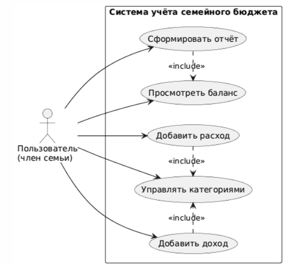
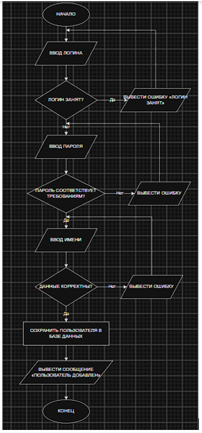
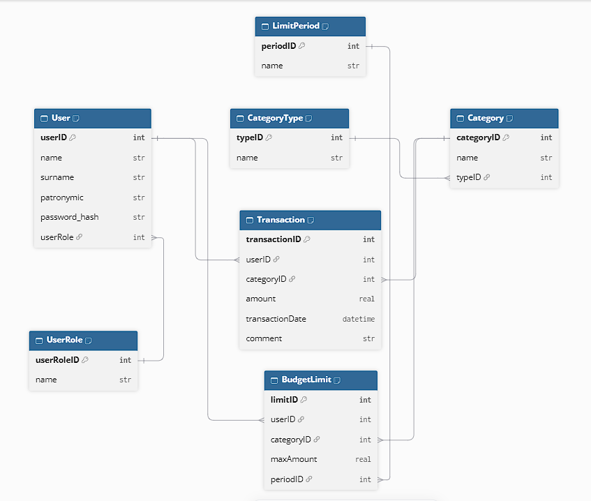

# Учёт семейного бюджета

## Лабораторная работа №4

### Реализация слоя доступа к данным, бизнес-логики и пользовательского интерфейса

**Автор:** Грибанов Илья
**Группа:** 26-ИВТ-2-2

**Ссылка на репозиторий:** [https://github.com/igribanov365-cell/family_budget](https://github.com/igribanov365-cell/family_budget)

---

## О проекте

Консольное приложение для учёта семейного бюджета. Позволяет вести счета, доходы и расходы семьи, настраивать регулярные платежи, разделять права между Главой семьи и членами семьи, получать отчёты.

Приложение построено по многослойной архитектуре: модели данных, репозитории (работа с SQLite), сервисы (бизнес-логика) и консольный интерфейс. SQL-запросы находятся только в репозиториях, интерфейс обращается только к сервисам.

## База данных

Пять таблиц (см. ER-диаграмму ниже): `users`, `accounts`, `categories`, `regular_payments`, `transactions`. Схема и тестовые данные лежат в `schema.sql`. Для каждой таблицы реализованы модель (`dataclass`), репозиторий с CRUD и сервис.

## Функционал

- Авторизация и регистрация пользователей, пароли хранятся в виде хеша (PBKDF2)
- Разграничение ролей: **Глава** и **Член семьи**
- **Счета** с балансом и валютой
- **Транзакции** (доходы и расходы) с привязкой к счёту, способом оплаты (наличные/карта); баланс счёта пересчитывается автоматически при добавлении, изменении и удалении
- **Категории и подкатегории** (один уровень вложенности)
- **Регулярные платежи** (раз в месяц или неделю) с проведением платежа как обычной транзакции
- Управление **членами семьи** (Глава)
- Отчёт: доходы, расходы, остаток на счетах, суммы по категориям

### Бизнес-правила

- сумма больше нуля, дата в формате `ГГГГ-ММ-ДД`, существование категории, счёта и пользователя
- расход не может превысить остаток на счёте; нельзя удалить доход, если баланс станет отрицательным
- тип подкатегории совпадает с типом родительской категории
- нельзя удалить категорию, счёт или пользователя, на которые есть ссылки
- нельзя удалить или разжаловать последнего Главу семьи
- проверка уникальности логина, названий категорий и счетов владельца

## Роли и права

| Действие | Глава | Член семьи |
|---|---|---|
| Просмотр транзакций, счетов, регулярных платежей | всех | только своих |
| Добавление транзакций | по своим счетам | по своим счетам |
| Изменение и удаление транзакций | любых | только своих |
| Управление счетами | любыми | только своими |
| Управление категориями | да | только просмотр |
| Управление членами семьи | да | нет |
| Отчёт | по всей семье | по своим данным |

## Запуск

```
cd src/family_budget
python main.py
```

На Windows, если команда `python` не работает, используйте `py main.py`. Требуется Python 3.10 или новее.

База данных `family_budget.db` создаётся автоматически из `schema.sql` при первом запуске. Чтобы вернуть тестовые данные, удалите файл `family_budget.db` и запустите программу снова.

### Тестовые пользователи

| Логин | Пароль | Роль |
|---|---|---|
| papa | 1234 | Глава |
| mama | 1234 | Член семьи |
| son | 1234 | Член семьи |

## Тестирование

```
pytest
```

Тесты слоя сервисов находятся в `tests/test_layers.py`: авторизация, права по ролям, валидация данных, пересчёт баланса счетов, подкатегории, регулярные платежи, отчёты.

## Структура проекта

```
family_budget/                      # Корневая папка проекта
│
├── README.md                       # Описание проекта
├── .gitignore                      # Исключения Git
├── requirements.txt                # Зависимости
├── schema.sql                      # Схема БД и тестовые данные
│
├── src/                            # Исходный код
│   └── family_budget/              # Основной пакет
│       ├── main.py                 # Точка входа
│       ├── budget.py               # Логика бюджета (ЛР №2)
│       │
│       ├── database/               # Подключение к БД
│       │   └── database.py         # get_connection(), init_db()
│       │
│       ├── models/                 # Модели данных (dataclass)
│       │   ├── user.py
│       │   ├── account.py
│       │   ├── category.py
│       │   ├── regular_payment.py
│       │   └── transaction.py
│       │
│       ├── repositories/           # Слой доступа к данным (SQL, CRUD)
│       │   ├── user_repository.py
│       │   ├── account_repository.py
│       │   ├── category_repository.py
│       │   ├── regular_payment_repository.py
│       │   └── transaction_repository.py
│       │
│       ├── services/               # Бизнес-логика
│       │   ├── auth_service.py
│       │   ├── user_service.py
│       │   ├── account_service.py
│       │   ├── category_service.py
│       │   ├── regular_payment_service.py
│       │   ├── transaction_service.py
│       │   ├── report_service.py
│       │   ├── constants.py
│       │   └── errors.py
│       │
│       └── ui/                     # Консольный интерфейс
│           ├── auth.py             # Вход и регистрация
│           ├── menus.py            # Меню по ролям
│           └── console.py          # Вспомогательные функции ввода/вывода
│
├── tests/                          # Тесты
│   ├── test_budget.py
│   └── test_layers.py
│
└── docs/                           # Документация
    └── diagrams/                   # Диаграммы PlantUML
```

## Диаграммы

### Use Case диаграмма



### Блок-схема: добавление дохода/расхода


### Блок-схема: регистрация нового члена семьи



### ER-диаграмма базы данных



## Технологии

- **Python 3** — язык
- **SQLite** (модуль `sqlite3`) — база данных
- **dataclasses** — модели данных
- **pytest** — тесты
- **Git / GitHub** — контроль версий и хостинг
- **Markdown** и **PlantUML** — документация и диаграммы
