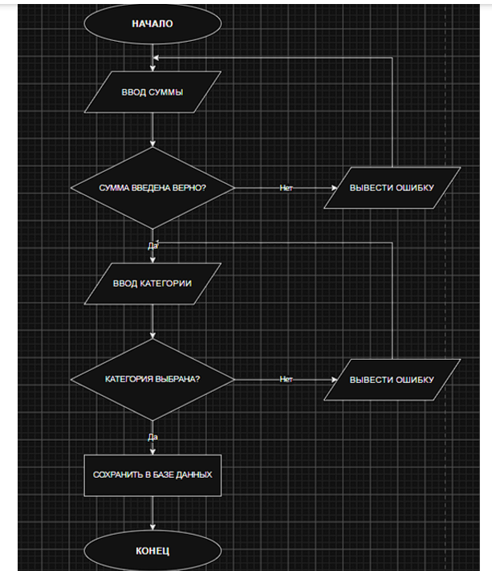

# Учёт семейного бюджета

## Лабораторная работа №5

### ФОРМАТЫ ДАННЫХ: JSON, CSV, XML, YAML

**Автор:** Грибанов Илья **Группа:** 26-ИВТ-2-2 **Ссылка на репозиторий:** [https://github.com/igribanov365-cell/family_budget](https://github.com/igribanov365-cell/family_budget)

* * *

## О проекте

Программа для учёта семейного бюджета. Позволяет добавлять доходы и расходы семьи, считать баланс и формировать отчёт.

## Функционал

- Добавление **доходов** (категория + сумма)
- Добавление **расходов** (категория + сумма)
- Подсчёт общего дохода, расхода и **баланса**
- Формирование текстового отчёта

## Пример работы

```
Hello, first-year student!

=== Отчёт по семейному бюджету ===
Доходы:  157000.00 руб.
Расходы: 57000.00 руб.
Баланс:  100000.00 руб.
```

## Запуск

```
cd src/family_budget
python main.py
```

## Тестирование

```
pytest
```

## Структура проекта

```
family_budget/                      # Корневая папка проекта
│
├── .git/                           # Скрытая папка Git
├── README.md                       # Описание проекта
├── .gitignore                      # Исключения Git
├── requirements.txt                # Зависимости
│
├── src/                            # Исходный код
│   └── family_budget/              # Основной пакет
│       ├── __init__.py             # Инициализация пакета
│       ├── main.py                 # Точка входа
│       └── budget.py               # Логика бюджета
│
├── tests/                          # Тесты
│   ├── __init__.py
│   └── test_budget.py
│
└── docs/                           # Документация
    └── diagrams/                   # Диаграммы PlantUML
        ├── use_case.puml
        └── use_case.png
```

## Диаграммы

### Use Case диаграмма

[](https://github.com/igribanov365-cell/family_budget/blob/main/docs/diagrams/use_case.png)

### Блок-схема: добавление дохода/расхода

[](https://github.com/igribanov365-cell/family_budget/blob/main/docs/diagrams/flow_add_transaction.png)

### Блок-схема: регистрация нового члена семьи

[](https://github.com/igribanov365-cell/family_budget/blob/main/docs/diagrams/flow_registration.png)

### ER-диаграмма базы данных

[](https://github.com/igribanov365-cell/family_budget/blob/main/docs/diagrams/ERD.png)

## Технологии

- **Git** — контроль версий
- **GitHub** — хостинг
- **Markdown** — разметка
- **PlantUML** — UML-диаграммы
- **Python 3** — язык
- **pytest** — тесты

* * *

### Форматы данных: JSON, CSV, XML, YAML

Скрипт `src/family_budget/export_data.py` извлекает все записи таблицы `transactions` (связана с `users` и `categories`) и сохраняет их в папку `out/`:

- `data.json` — данные в формате JSON;
- `data.csv` — данные в формате CSV;
- `data.xml` — данные в формате XML;
- `data.yaml` — данные в формате YAML.

Особенности:

- в JSON, XML и YAML связанные данные вложены в объекты `user` и `category`;
- в CSV связанные поля объединены в одну строку (`user_username`, `category_name`, ...);
- папка `out/` создаётся автоматически, если её нет;
- внешние ключи определяются автоматически (`PRAGMA foreign_key_list`), JOIN-запрос строится динамически, поэтому для другой таблицы достаточно передать её имя.

Запуск:

```
pip install -r requirements.txt
cd src/family_budget
python export_data.py            # таблица transactions
python export_data.py users      # любая другая таблица
```

Тесты экспорта:

```
pytest tests/test_export_data.py
```
